<center><h1>easy-spring-boot-api框架</h1></center>

# 传送门

**[Gitee源码地址：https://gitee.com/pddon/easy-spring-boot-api](https://gitee.com/pddon/easy-spring-boot-api)**

**[演示地址：https://demo.pddon.cn/doc.html(暂未部署)](http://www.pddon.com:8181/doc.html)**

# 1、应用场景

## 简介
> 本项目是基于springboot的api接口开发框架，可用于构建OpenAPI、业务系统的接口服务器等等。其特点如下：
>
> * 简化接口开发、接口对接工作
> * 增强接口易用性、安全性
> * 标准化接口请求/响应参数、格式、错误码、异常处理、国际化翻译、接口日志、接口调用频次控制
> * 增加了一些通用功能支持（如：缓存、锁、防重提交、接口覆盖、会话控制等等）。
> * 通过其提供的注解功能即可启用，可以做到零配置零代码即可集成常用api开发需要的所有基础能力。
> * 支持常用api的灵活自定义实现，包括且不限于加签验签、加解密算法等等功能！
> * 支持yaml配置启停各种预置功能
> * 提供多种客户端包接入，现已提供java版本和Typescript版本客户端包
>
> 集成该项目后，不用再从零实现api安全、加签、验签、加解密、数据脱敏、异常处理、国际化、接口文档、错误码、缓存、会话、接口替换、分布式锁、应用、渠道管理等等功能。
>
> * java版本客户端就在此项目下：easy-spring-boot-api-client
> * TS版本客户端地址：[https://github.com/pddon/easy-api-client](https://github.com/pddon/easy-api-client)
>
> 快速入门教程： https://github.com/pddon/easy-spring-boot-api/blob/main/doc/quickStart.md

## 1.1 项目架构说明
### 1.1.1 easy-spring-boot-api跟Springboot的关系

1. 说明
    * easy-spring-boot-api是基于springboot开发的，自然强依赖于springboot
    * easy-spring-boot-api在springboot提供的能力之上，为开发者开发API接口提供了很多通用功能，比如接口安全（加签、验签、加解密、数据脱敏）、参数校验、防重复提交、缓存、锁、异常处理、请求响应格式规范和自动包装、国际化翻译、api接入应用渠道管理、接口文档等等功能，提供了默认实现，且支持自定义替换或拓展相关功能

2. 示意图

    * easy-spring-boot-api使用了springboot带来的所有便利，其在springmvc的基础上提供了额外的功能增强，如下图所示

        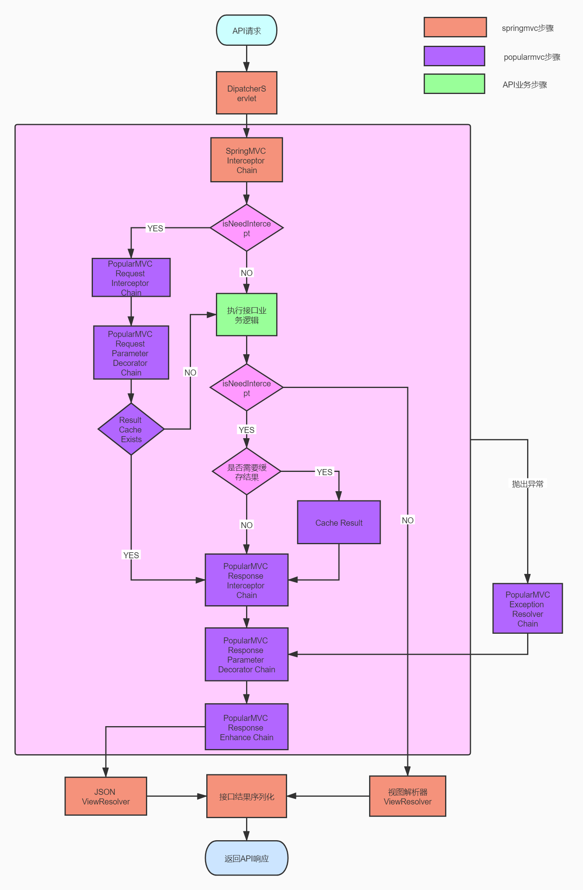

### 1.1.2 easy-spring-boot-api项目组件架构解析
* 架构图

    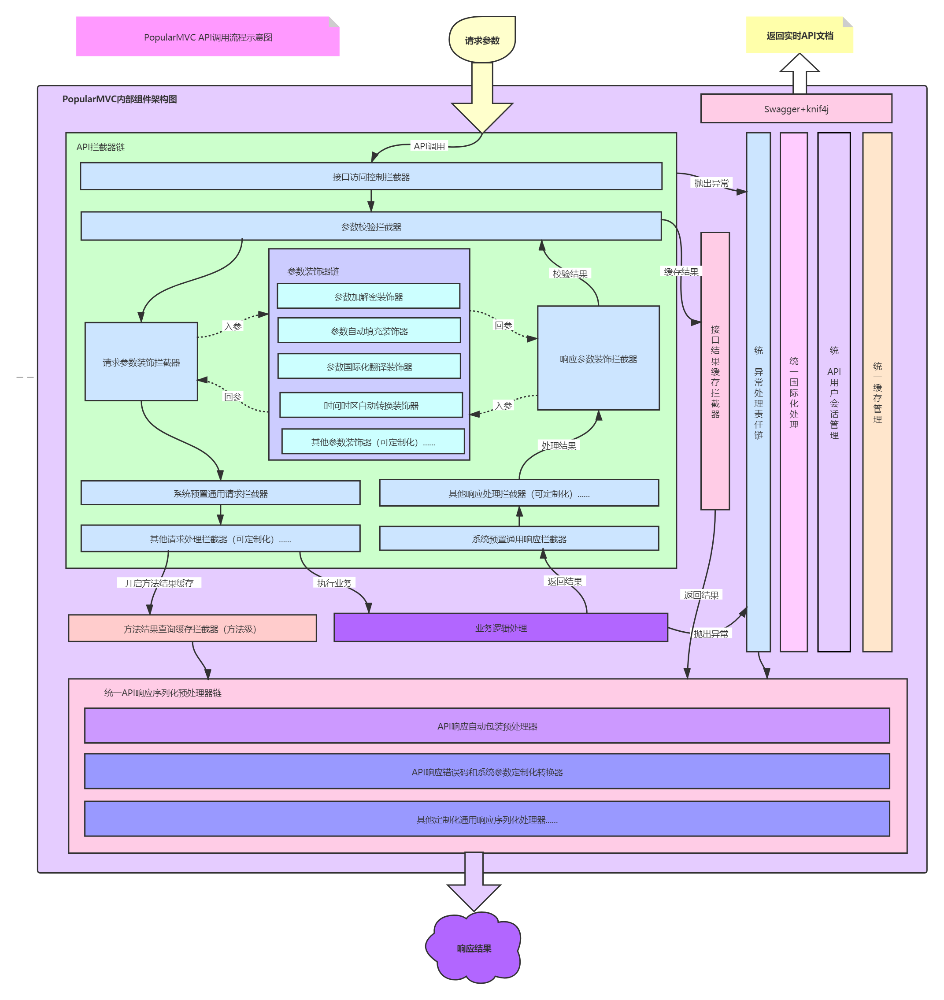

* 组件介绍

    主要分为以下几类组件

     1. API调用拦截器

        > 基于AOP切面设计的一套API请求、响应拦截处理流程。提供了在调用接口前后做一些通用的预处理，比如说参数校验、参数装饰、访问控制、日志输出、会话控制等等。目前内置的拦截器有：
        >
        > * 系统参数校验器
        > * 请求参数校验器
        > * 数字签名请求验签器、响应加签器
        > * 接口防重复提交控制器
        > * 接口用户会话控制器
        > * 接口日志打印器
        > * 接口访问控制器
        > * 请求、响应内容装饰器
        >
        > 也支持业务灵活定制通用的API调用拦截器。

     2. 参数装饰器

        > 参数装饰器机制通过遍历参数内容，逐个字段进行修饰，具体修饰规则由特定的装饰器制定。常见的使用场景有，对请求参数解密、响应参数加密、响应参数国际化、响应参数脱敏等等
        >
        > 注意：参数装饰器只能对参数内容做修饰，而无法改变参数类型。
        >
        > 目前内置的参数装饰器有：
        >
        > * 请求参数解密器
        > * 响应参数加密器
        > * 系统参数自动填充器
        > * 响应参数国际化翻译器
        >
        > 也支持业务灵活拓展参数装饰器。

     3. API响应序列化预处理器

        > 响应预处理器机制可以在接口返回内容给调用者之前进行额外的处理，此时可以更灵活的修饰返回内容，可以突破无法修改参数类型的限制，适用于对整个响应结构定制化处理的场景。
        >
        > 目前内置的响应预处理器有：
        >
        > * API响应自动包装预处理器
        > * API响应错误码和系统参数定制化转换器
        >
        > 当然，也支持业务灵活拓展。

     4. 方法查询缓存拦截器

        > 提供对查询类方法调用的结果进行缓存。

     5. API异常统一处理器

        > 接口调用过程中任何步骤出现异常，均能自动处理，并反馈信息给调用者。
        >
        > 支持对特定异常自定义处理，如果未处理，统一交由内置的默认异常处理器进行护理。

     6. 统一国际化翻译管理器

        > 接口返回内容均支持国际化翻译能力。
        >
        > 已整合了spring i18n国际化翻译能力，也支持拓展业务自定义国际化翻译器。

     7. 统一错误码管理器

        > 研发人员无需再关注业务错误码的定义和国际化翻译工作，可以做到定义简单、使用简单、易于理解、配置灵活
        >
        > * 支持自定义系统错误码、业务错误码
        > * 支持业务错误码自动生成
        > * 支持业务错误码以异常的方式抛出，系统自动处理

     8. 方法分布式锁拦截器

        > 提供注解标注方法是否需要启用分布式锁，解决接口并发问题

     9. 接口替换功能

        > 通过注解配置实现替换系统已有接口，拓展其功能，可用于一些基于标准项目的客开项目定制化开发

     10. 自动接口文档生成器

         > 已内置swagger+knif4j，只需指定API包路径即可实现接口文档的自动生成。

     11. 其他更多功能就不一一赘述，等你来发现哦。。。。。。

## 1.2 其他说明
* 如果你有遇到如下困扰时，你也许可以尝试使用easy-spring-boot-api框架 
  >
  >1. 服务器API缺乏统一标准的输入输出参数，难以统一规范开发人员的接口格式
  >
  >2. 缺乏简单、高效、统一的接口异常处理机制
  >
  >3. 绞尽脑汁思考错误码的命名、编号和处理机制
  >
  >4. 虽然使用参数校验注解校验API请求参数已经非常方便，但是又对其缺乏校验结果的统一处理而苦恼
  >
  >5. 项目服务于多个国家的用户，繁重的国际化工作也许会让你崩溃
  >
  >6. API缺乏权限控制、安全认证、数据加密、防重复提交等等，直接裸奔
  >
  >7. 还没有找到顺手的服务器缓存工具，对springcache的注解槽点满满等
  >
  >8. 时常为了写接口文档而占用太多coding time，而且接口文档还无法实时与接口变更保持同步

  > 现在你有福了，你只需要引入easy-spring-boot-api框架，并为你的SpringBoot应用添加`@EnableEasyApi`注解，即可解决上述所有的困扰！

* easy-spring-boot-api为你默默做了哪些工作呢？

    * 首先，easy-spring-boot-api是基于springboot的web应用框架，享受了springboot带来的一切便利性
    * 再者，其对开发WEB JSON API 的规范性、易用性、健壮性做了很多的业务增强

* easy-spring-boot-api的存在意义在哪？

    > 一个字，那就是"爽"，让开发者爽，让接口使用者爽！

    * 规范web应用的API输入输出
    * 简化开发人员的工作，节省研发成本！

* easy-spring-boot-api提供的业务功能有哪些呢？

    > 其提供了如下业务功能：
    >
    > 1. 规范API请求参数，支持系统参数名自定义和系统参数的拓展，系统参数的校验等等
    > 2. 规范API响应参数，支持系统参数名自定义和添加额外的系统参数
    > 3. API响应信息自动补全系统参数，开发者无需再手动添加响应壳信息
    > 4. 应用内统一的国际化翻译能力，已经整合spring i18n，而且支持业务灵活拓展国际化能力
    > 5. 接口响应信息国际化，为需要国际化的字段添加`@LanguageTranslate`注解即可自动翻译内容后返回给调用者
    > 6. 统一的异常处理机制，全局拦截API调用异常并处理，处理结果经国际化处理后以标准的API响应格式返回给调用者，业务侧可以对特定异常进行灵活处理
    > 7. 简单易用的接口错误码，发现不满足API执行条件，直接抛出`BusinessException`异常即可通过统一异常处理机制得到预期的API响应。支持自定义系统错误码、业务错误码；依据业务错误码KEY值自动生成错误码数值；并可以对服务内的自动生成的业务错误码值进行范围限制，这样有助于不同业务服务间的错误码分段；
    > 8. API请求参数、响应参数的自动校验，校验结果自动处理后通过API响应反馈给调用者
    > 9. 简单方便的缓存管理器，使用Guava cache作为默认的本地缓存管理器，支持缓存管理器的灵活拓展，提供`@CacheMethodResult`和`@CacheMethodResultEvict`注解实现方法接口结果的缓存和失效
    > 10. 接口安全相关组件，验签、加解密、防重复提交等等，使用时只需要为你的API添加一个注解即可搞定
    > 11. 接口会话管理机制，默认提供本地会话管理器；引入可选Redis状态存储后自动切换为跨实例共享会话（见5.5），也支持业务灵活定制会话管理器
    > 12. 接口文档化支持，提供了swagger接口文档自动生成，并整合了knife4j提供简单易用的实时api文档，支持在线调试和多种格式的离线导出
    > 13. 接口调用日志打印，提供对接口请求参数信息、接口响应信息的简要打印，预留了接口调用日志持久化机制，用于业务方定制流量监控相关功能
    > 14. 更多分布式缓存、数据存储相关功能(迭代加)
    > 15. web容器性能参数优化（迭代加）
    > 16. 接口实时流量监控和管理（迭代加）
    > 17. 更细粒度的接口访问权限控制（迭代加），主要为应用提供简洁易用的内置权限管理组件
    > 18. 日志采集功能的集成支持（迭代加）
    > 19. devops的支持（迭代加）

# 2、项目模块

## 2.1 项目模块介绍

| 模块                        | 说明                                    | 地址                                                         |
| --------------------------- | --------------------------------------- | ------------------------------------------------------------ |
| easy-spring-boot-api        | 为springboot应用提供API业务增强解决方案 | https://mvnrepository.com/artifact/com.pddon.framework/easy-spring-boot-api |
| easy-spring-boot-api-demo   | EasyApi框架使用完整示例demo             | https://github.com/pddon/easy-spring-boot-api/tree/master/easy-spring-boot-api-demo |
| easy-spring-boot-api-client | EasyApi框架java版客户端工具包           | https://github.com/pddon/easy-spring-boot-api/tree/master/easy-spring-boot-api-client |

## 2.2 项目版本依赖

- **easy-spring-boot-api 1.0.x-1.1.x版本使用到的第三方依赖如下所示**

    |                       Category/License                       |                                                              | Group / Artifact                                             |                           Version                            |                           Updates                            |
    | :----------------------------------------------------------: | ------------------------------------------------------------ | ------------------------------------------------------------ | :----------------------------------------------------------: | :----------------------------------------------------------: |
    | [Bytecode](https://mvnrepository.com/open-source/bytecode-libraries) Apache 2.0 |  | [cglib](https://mvnrepository.com/artifact/cglib) » [cglib-nodep](https://mvnrepository.com/artifact/cglib/cglib-nodep) | [ 3.1](https://mvnrepository.com/artifact/cglib/cglib-nodep/3.1) | [3.3.0](https://mvnrepository.com/artifact/cglib/cglib-nodep/3.3.0) |
    |                          Apache 2.0                          |  | [com.github.xiaoymin](https://mvnrepository.com/artifact/com.github.xiaoymin) » [knife4j-spring-boot-starter](https://mvnrepository.com/artifact/com.github.xiaoymin/knife4j-spring-boot-starter) | [ 2.0.6](https://mvnrepository.com/artifact/com.github.xiaoymin/knife4j-spring-boot-starter/2.0.6) | [3.0.3](https://mvnrepository.com/artifact/com.github.xiaoymin/knife4j-spring-boot-starter/3.0.3) |
    | [Base64](https://mvnrepository.com/open-source/base64-libraries) Apache 2.0 |  | [commons-codec](https://mvnrepository.com/artifact/commons-codec) » [commons-codec](https://mvnrepository.com/artifact/commons-codec/commons-codec) | [ 1.14](https://mvnrepository.com/artifact/commons-codec/commons-codec/1.14) | [1.16.1](https://mvnrepository.com/artifact/commons-codec/commons-codec/1.16.1) |
    |                        Apache 2.0MIT                         |  | [net.logstash.logback](https://mvnrepository.com/artifact/net.logstash.logback) » [logstash-logback-encoder](https://mvnrepository.com/artifact/net.logstash.logback/logstash-logback-encoder) | [ 5.0](https://mvnrepository.com/artifact/net.logstash.logback/logstash-logback-encoder/5.0) | [7.4](https://mvnrepository.com/artifact/net.logstash.logback/logstash-logback-encoder/7.4) |
    | [AOP](https://mvnrepository.com/open-source/aop-programming) EPL 2.0 |  | [org.aspectj](https://mvnrepository.com/artifact/org.aspectj) » [aspectjweaver](https://mvnrepository.com/artifact/org.aspectj/aspectjweaver) | [ 1.9.6](https://mvnrepository.com/artifact/org.aspectj/aspectjweaver/1.9.6) | [1.9.21.2](https://mvnrepository.com/artifact/org.aspectj/aspectjweaver/1.9.21.2) |
    | [CodeGen](https://mvnrepository.com/open-source/code-generators) MIT |  | [org.projectlombok](https://mvnrepository.com/artifact/org.projectlombok) » [lombok](https://mvnrepository.com/artifact/org.projectlombok/lombok) (optional) | [ 1.18.20](https://mvnrepository.com/artifact/org.projectlombok/lombok/1.18.20) | [1.18.32](https://mvnrepository.com/artifact/org.projectlombok/lombok/1.18.32) |
    | [Validation](https://mvnrepository.com/open-source/validation) Apache 2.0 |  | [org.springframework.boot](https://mvnrepository.com/artifact/org.springframework.boot) » [spring-boot-starter-validation](https://mvnrepository.com/artifact/org.springframework.boot/spring-boot-starter-validation) | [ 2.3.12.RELEASE](https://mvnrepository.com/artifact/org.springframework.boot/spring-boot-starter-validation/2.3.12.RELEASE) | [3.2.4](https://mvnrepository.com/artifact/org.springframework.boot/spring-boot-starter-validation/3.2.4) |
    | [Web Framework](https://mvnrepository.com/open-source/web-frameworks) Apache 2.0 |  | [org.springframework.boot](https://mvnrepository.com/artifact/org.springframework.boot) » [spring-boot-starter-web](https://mvnrepository.com/artifact/org.springframework.boot/spring-boot-starter-web)[1 vulnerability ](https://mvnrepository.com/artifact/org.springframework.boot/spring-boot-starter-web/2.3.12.RELEASE) | [ 2.3.12.RELEASE](https://mvnrepository.com/artifact/org.springframework.boot/spring-boot-starter-web/2.3.12.RELEASE) | [3.2.4](https://mvnrepository.com/artifact/org.springframework.boot/spring-boot-starter-web/3.2.4) |
    |                          Apache 2.0                          |  | [org.springframework.boot](https://mvnrepository.com/artifact/org.springframework.boot) » [spring-boot-starter-undertow](https://mvnrepository.com/artifact/org.springframework.boot/spring-boot-starter-undertow) | [ 2.3.12.RELEASE](https://mvnrepository.com/artifact/org.springframework.boot/spring-boot-starter-undertow/2.3.12.RELEASE) | [3.2.4](https://mvnrepository.com/artifact/org.springframework.boot/spring-boot-starter-undertow/3.2.4) |
    | [App Server](https://mvnrepository.com/open-source/application-servers) Apache 2.0 |  | [org.springframework.boot](https://mvnrepository.com/artifact/org.springframework.boot) » [spring-boot-starter](https://mvnrepository.com/artifact/org.springframework.boot/spring-boot-starter) (optional) | [ 2.3.12.RELEASE](https://mvnrepository.com/artifact/org.springframework.boot/spring-boot-starter/2.3.12.RELEASE) | [3.2.4](https://mvnrepository.com/artifact/org.springframework.boot/spring-boot-starter/3.2.4) |
    | [Annotation Tool](https://mvnrepository.com/open-source/annotation-tools) Apache 2.0 |  | [org.springframework.boot](https://mvnrepository.com/artifact/org.springframework.boot) » [spring-boot-configuration-processor](https://mvnrepository.com/artifact/org.springframework.boot/spring-boot-configuration-processor) (optional) | [ 2.3.12.RELEASE](https://mvnrepository.com/artifact/org.springframework.boot/spring-boot-configuration-processor/2.3.12.RELEASE) | [3.2.4](https://mvnrepository.com/artifact/org.springframework.boot/spring-boot-configuration-processor/3.2.4) |

# 3、入门demo

> 此demo是使用easy-spring-boot-api的入门示例，演示了easy-spring-boot-api在无侵入的模式下为你的项目提供了参数校验、业务异常的使用等功能，为了简化入门门槛，暂未提供其他功能的示例，如果需要学习使用更多功能，[请参考更多示例](doc/demos.md)。

> **demo与测试说明**：`easy-spring-boot-api-demo`已加入根POM的modules，默认`skipTests=true`不影响打包。构建后可直接运行的可执行jar为`target/easy-spring-boot-api-demo-<version>-exec.jar`（Spring Boot标准`BOOT-INF/lib`结构）；
> 包内普通瘦jar`easy-spring-boot-api-demo-<version>.jar`不包含依赖，不能直接启动；`-bin.zip`为assembly生成的`lib/ + conf/ + bin/`部署包，仅在`mvn install`后产生。
> 启动示例使用随机端口：`java -jar target/easy-spring-boot-api-demo-<version>-exec.jar --server.port=0`（默认配置为`8282`、`context-path=/test`）。
> 需要运行测试时执行`mvn -o -pl easy-spring-boot-api-demo -am test -DskipTests=false -Dtest=DemoEndToEndTest -DfailIfNoTests=false`。
> 端到端测试使用随机端口启动demo（`--server.port=0`），不依赖固定端口，也不会与本地已启动的服务冲突。
> **部署包说明**：`-bin.zip`仅由`mvn install`生成，目录为`bin/ + conf/ + lib/`。`bin/*.sh`启动脚本仅适用于POSIX环境（需要`sh`/`bash`、`JAVA_HOME`、`jps`），Windows请直接使用`-exec.jar`。外置`conf/application.yml`由`startup.sh`通过`--spring.config.additional-location=file:$APP_HOME/conf/`叠加加载，优先级高于jar内`application.yml`，只覆盖同名键；可覆盖项为`server.port`、`server.undertow.*`、`logging.level.*`、`easyapi.state-store.*`、`spring.redis.*`，业务密钥不要放在该文件。
> 已知风险：`lib/`中`swagger-annotations`、`swagger-models`各存在`1.5.22`与`2.1.2`双版本（框架显式依赖与knife4j传递依赖冲突），扁平classpath下生效顺序取决于文件名顺序，两种启动方式均实测可用，暂未调整pom。

## 3.1 项目结构

* 项目结构

    ```ruby
    ├─src
    │  └─main
    │     ├─java
    │     │  └─com
    │     │      └─pddon
    │     │          └─framework
    │     │              └─demo
    │     │                  └─easyapi
    │     │                      ├─controller
    │     │                      │  │      
    │     │                      │  └─ TestController.java
    │     │                      │          
    │     │                      └─startup
    │     │                              StartDemoApplication.java #项目启动类
    │     │                              
    │     └─resources
    │         │  application.yml  #项目配置信息，可省略
    │         │  
    │         └─i18n #自定义国际化支持，可省略
    │             └─messages #项目自定义国际化翻译信息
    │                     messages.properties
    │                     messages_en_US.properties
    │                     messages_zh_CN.properties
    │                     #还可添加其他国际化翻译内容
    └─  pom.xml
    ```

* 引入模块依赖，在`pom.xml`添加

```xml
	<dependency>
		<groupId>com.pddon.framework</groupId>
		<artifactId>easy-spring-boot-api</artifactId>
		<version>${easy-spring-boot-api.version}</version>
	</dependency>
```

## 3.2 启用easy-spring-boot-api框架

```java
/**  
* Title StartDemoApplication.java  
* Description  
* @author danyuan
* @date Oct 31, 2020
* @version 1.0.0
* site: www.pddon.com
*/ 
package com.pddon.framework.demo.easyapi;

import org.springframework.boot.SpringApplication;
import org.springframework.boot.autoconfigure.SpringBootApplication;
import com.pddon.framework.EnableEasyApi;

@SpringBootApplication
@EnableEasyApi
public class StartDemoApplication {

	public static void main(String[] args) {
		SpringApplication.run(StartDemoApplication.class, args);
	}
}

```

## 3.3 测试接口代码示例

* 代码如下，`TestController.java`

    ```java
    /**  
    * Title TestController.java  
    * Description  
    * @author danyuan
    * @date Dec 27, 2020
    * @version 1.0.0
    * site: www.pddon.com
    */ 
    package com.pddon.framework.demo.easyapi.controller;
    
    import java.util.HashMap;
    import java.util.Map;
    
    import javax.validation.Valid;
    import javax.validation.constraints.NotBlank;
    import javax.validation.constraints.NotEmpty;
    import javax.validation.constraints.Size;
    
    import org.springframework.validation.annotation.Validated;
    import org.springframework.web.bind.annotation.GetMapping;
    import org.springframework.web.bind.annotation.PostMapping;
    import org.springframework.web.bind.annotation.RequestParam;
    import org.springframework.web.bind.annotation.RestController;
    
    import com.pddon.framework.easyapi.BusinessException;
    
    @RestController
    @Validated
    public class TestController {
    	
    	/**
    	 * 参数自动校验、响应内容自动包装功能示例
    	 * @author danyuan
    	 */
    	@GetMapping("queryUserInfo")	
    	public Map<String,Object> queryUserInfo(@Valid @Size(max=20, min=6) @NotBlank @RequestParam String username){
    		
    		System.out.println("查询用户["+username+"]的信息!");
    		
    		//TODO: 执行业务逻辑
    		
    		//mock数据
    		Map<String,Object> userInfos = new HashMap<>();
    		userInfos.put("username", username);
    		userInfos.put("age", 23);
    		userInfos.put("sex", "男");
    		userInfos.put("desc", "阳光乐观外向，喜欢唱歌、打篮球！");
    		
    		//返回数据
    		return userInfos;
    	}
    	
    	/**
    	 * 业务异常的使用示例
    	 * @author danyuan
    	 */
    	@PostMapping("user/regist")	
    	public void userRegist(@Valid @NotEmpty String username, 
    			@Valid @NotEmpty String password){
    		//TODO: 执行业务逻辑，发现账号已存在，直接通过抛出异常的方式提示用户
    		throw new BusinessException("用户名[{0}]已存在，请更换!").setParam(username);
    	}
    }
    ```

## 3.4 测试接口结果

>  接口文档访问地址：http://localhost:8080/doc.html

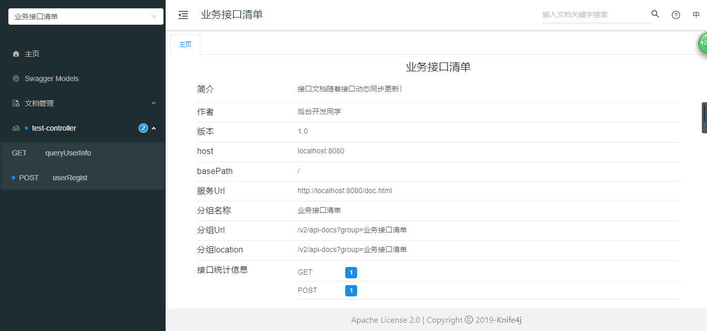

### 3.4.1 测试参数校验

* 请求参数

   * knif4j接口文档调试时自动提示参数不能为空

    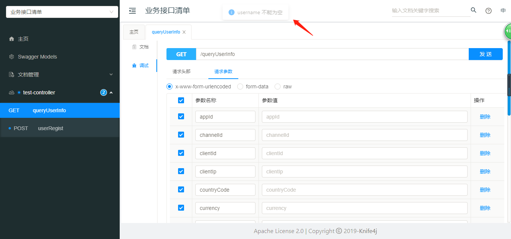

    * 提交非法请求参数

    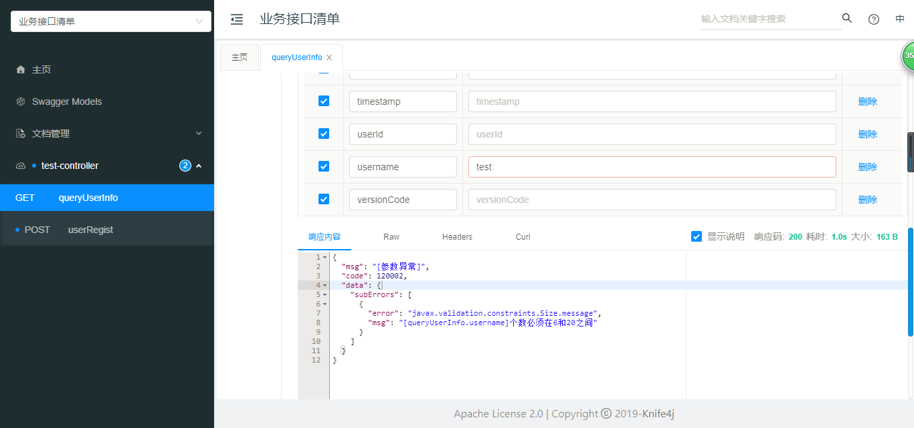

* 结果

    ```json
    {
      "msg": "[参数异常]", #错误信息概览
      "code": 120002, #系统错误码
      "data": {
        "subErrors": [
          {
            "error": "javax.validation.constraints.Size.message",#业务错误码
            "msg": "[queryUserInfo.username]个数必须在6和20之间" #详细错误信息
          }
        ]
      }
    }
    ```

### 3.4.2 测试正常响应信息返回

* 请求参数

    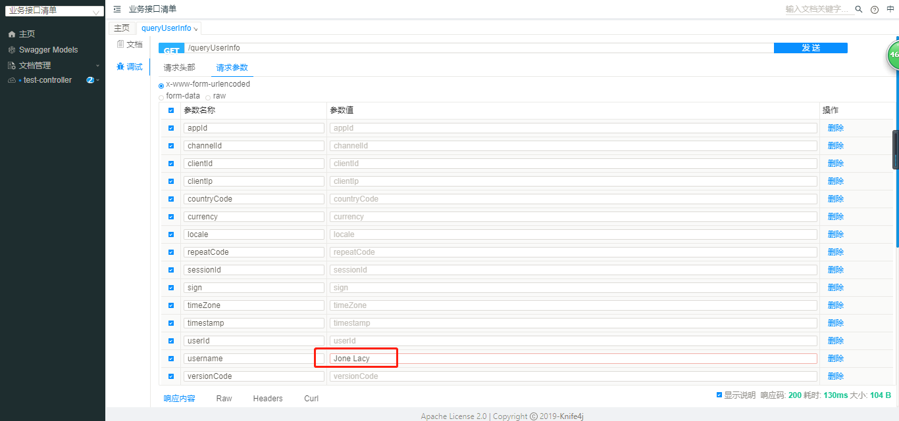

* 结果
     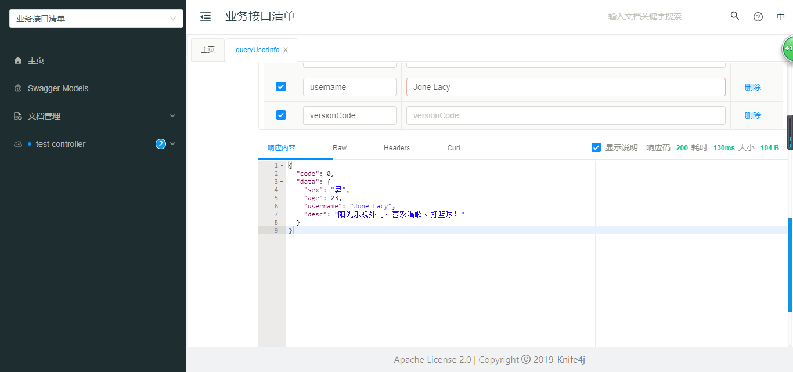

     ```json
     {
       "code": 0,
       "data": {
         "sex": "男",
         "age": 23,
         "username": "Jone Lacy",
         "desc": "阳光乐观外向，喜欢唱歌、打篮球！"
       }
     }
     ```

### 3.4.3 测试业务异常的使用

* 请求参数

    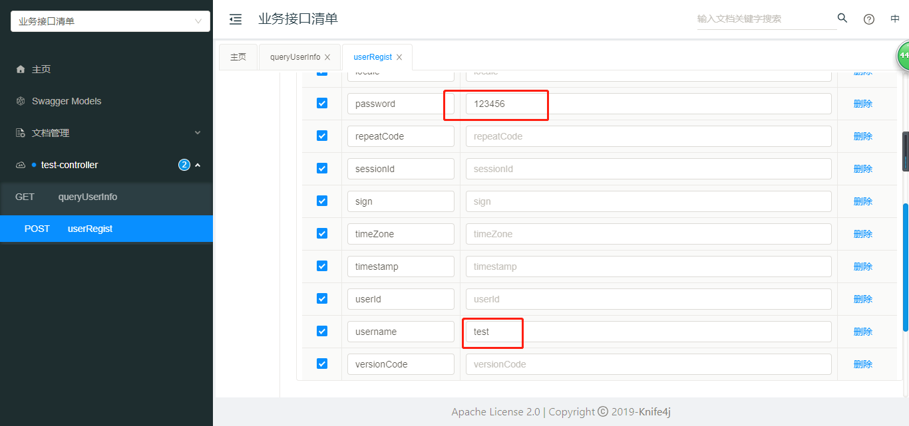

* 结果

    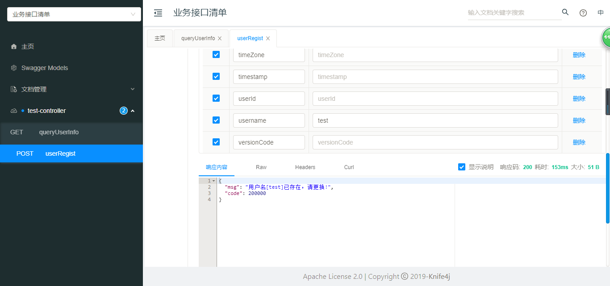

    ```json
    {
      "msg": "用户名[test]已存在，请更换!",
      "code": 200000
    }
    ```

    

## 3.5 更多功能示例

* 系统内置接口

    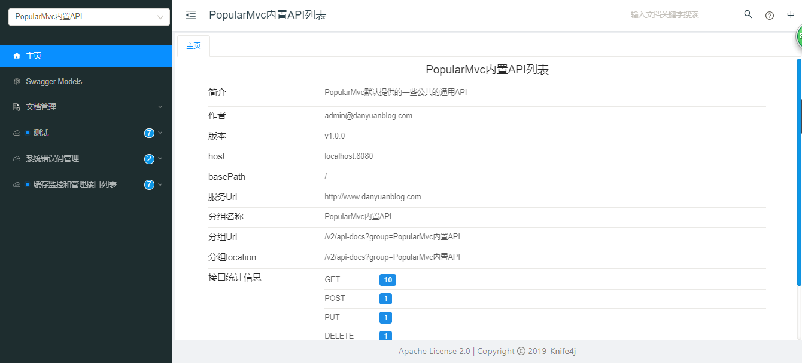

* 业务系统接口

    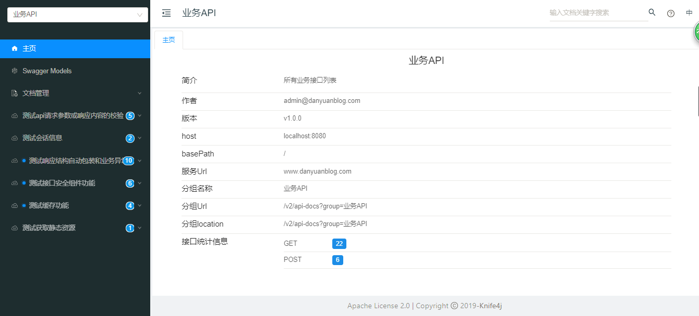

* 接口文档示例

    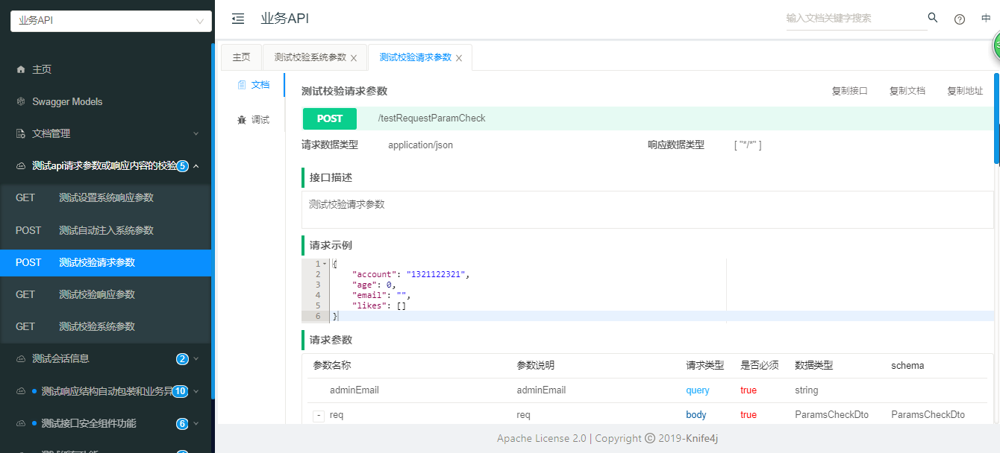

* 接口测试示例

    * 接口参数校验失败测试结果示例

        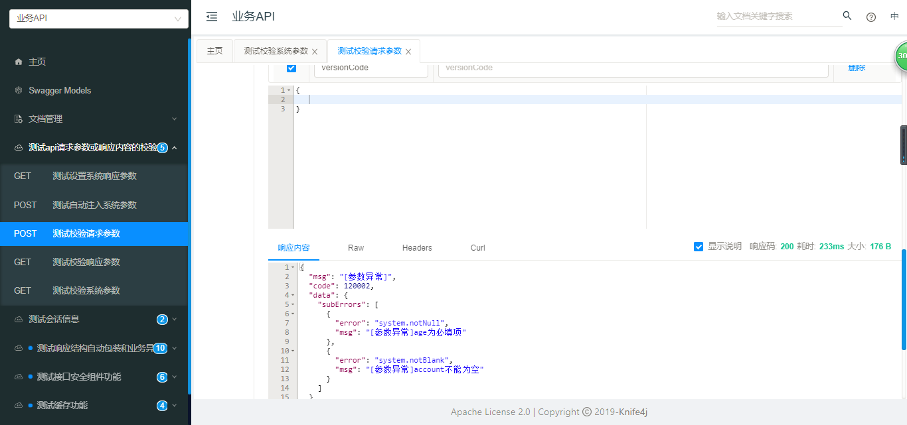

    * 接口访问成功结果示例

        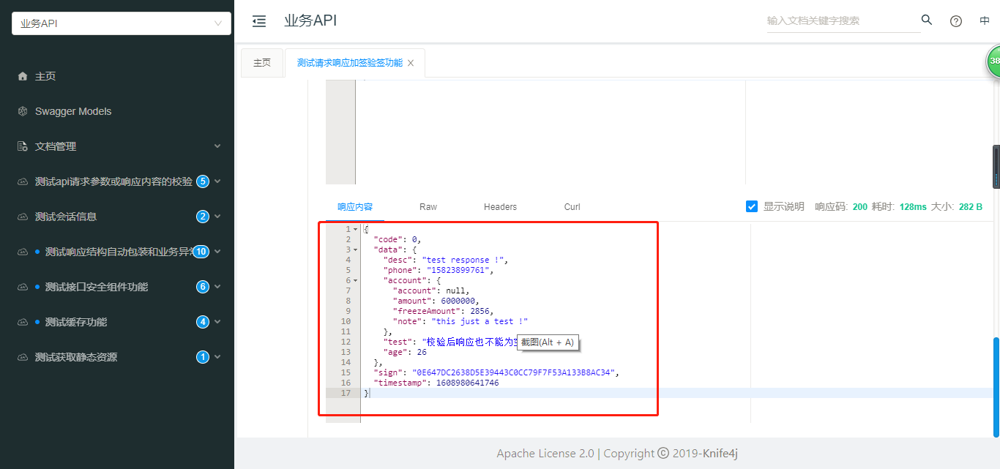

    * 国际化接口访问示例（英文）

        

        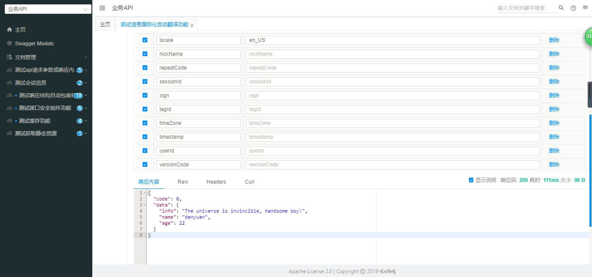

    * 国际化接口访问示例（中文）

        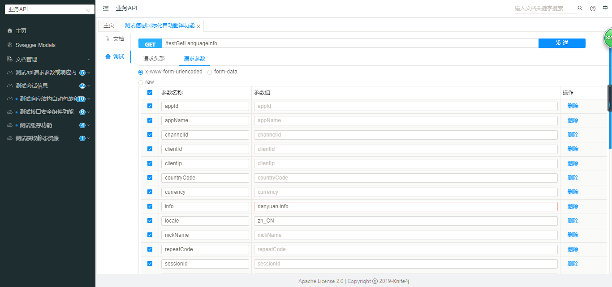

        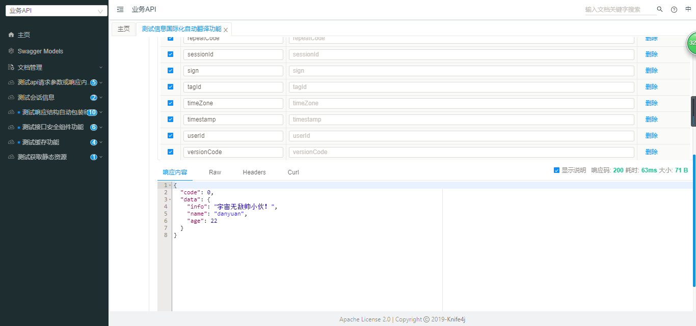

## 3.6 示例工程 simple-demos

> 位置：`easy-spring-boot-api-simple-demos`，与框架主仓库同级的独立 Maven 工程，包含 12 个可独立启动的功能示例模块（端口 8081–8092）。
>
> * 构建（跳过测试）：`mvn -o -DskipTests package`
> * 运行全部测试：`mvn -o test`（共 80 个用例，测试以 `--server.port=0` 随机端口启动）
> * 启动单个模块：`mvn -o -pl <module> spring-boot:run`，或在 IDE 中直接运行该模块的 `Startup` 启动类
>
> 各模块与功能的对应关系见 [doc/demos.md](doc/demos.md)。

# 4、更多特性介绍与使用示例

**[使用示例传送门](doc/demos.md)**

# 5、业务定制化

## 5.1 配置定制化

* 接口文档个性化

* 系统参数定制化
    * 系统公共请求参数名自定义
    * 添加额外的系统公共请求参数
    * 系统公共响应参数名自定义
    * 添加额外的系统响应参数

* 业务国际化内容

    > 可以通过springboot i18n添加或者定制国际化内容

## 5.2 组件定制化

> easy-spring-boot-api提供了灵活定制通用组件的能力。
>
> 1. 内置的几大管理器都可以替换成自定义的管理器，如：
>     * 缓存管理器
>     * 会话管理器
>     * 国际化管理器
>     * 数字签名管理器
>     * 秘钥管理器
>     * 应用管理器
>     * 接口日志管理器
>     * 接口调用频次控制管理器
> 2. 可以添加自定义接口调用拦截器，实现一些通用业务
> 3. 可以添加自定义接口请求、响应参数装饰器，对参数进行加工
> 4. 可以添加自定义响应序列化预处理器，根据业务需要定制化返回信息
> 5. 可以添加自定义异常处理器，为目标类型的异常做额外的处理
> 6. 可以灵活定制和使用自定义的加解密处理器

## 5.3 性能优化说明

> 以下优化均保持现有 public API、配置项语义、返回结构与日志语义不变，不改变接口的对外行为。

| 优化点 | 代码位置 | 优化方式 | 说明 |
| ------ | -------- | -------- | ---- |
| 启动类包名重复查找 | `ClassOriginCheckUtil.getDeafultBasePackage()` | 不做静态缓存，改由`EasyApiConfig`按配置实例缓存根包集合 | 静态缓存会在同一JVM的多个Spring上下文（如测试、父子上下文）间串值；按实例缓存既避免重复遍历容器，也不会跨上下文污染 |
| 根包集合重复构造 | `EasyApiConfig.getAllBasePackages()` | 结果缓存，`setBasePackages`时失效缓存 | 请求链路中多处调用该方法，原先每次都新建`HashSet`并再次触发启动类查找 |
| 字段与getter反射扫描 | `BeanPropertyUtil.getAllField`、`hasPublicGetter` | 用`ClassValue`按类缓存字段列表、getter判定结果、类注解 | `ClassValue`随类卸载自动释放，避免静态缓存持有类加载器；`getAllField`仍返回可变副本，调用方修改不影响内部缓存 |
| 可序列化字段清单重复扫描 | `BeanPropertyUtil.getSerializableFields` | 按“声明类 + 忽略注解类型”用`ClassValue`缓存“有公共getter且已设为可访问”的字段列表 | 原先每次序列化/装饰对象都要对每个字段重复做getter判定查询、注解扫描与`setAccessible`反射调用；字段清单与可访问性在运行期不变，缓存后每个字段只需一次反射取值。`objToStringMap`中位数由25942降到22669 ns/op（约-12.6%），对旧实现倍率5.85x；p95会受单轮样本过短影响出现波动 |
| 方法元数据重复反射 | `ApiInvokeMethodInterceptorManager` | 按声明类用`ClassValue`缓存参数名、方法注解、参数注解及是否拦截 | 避免每次请求重复解析参数名与注解；参数名解析失败时不缓存，保持与原实现一致的重试语义 |
| 响应参数装饰注解Map | `ApiDataFormatInterceptor` | 按声明类用`ClassValue`缓存方法注解Map | 原先每个响应都重新构造注解Map，缓存随类卸载释放 |
| 调用日志序列化开销 | `ApiLogInterceptor` | 复用`ObjectWriter`、用`convertValue`替代"序列化字符串再反序列化"、关闭INFO日志时跳过日志内容拼装 | 日志格式与内容不变；转换异常解包为原`JsonProcessingException`；INFO日志关闭时不再产生无用的JSON序列化开销 |
| 响应包装判断与内部序列化 | `AutoAddResponseWrapperHandler` | 用`ClassValue`按类缓存声明字段名，内部转换不再使用格式化输出 | 仅用于判断响应是否已带响应壳，与最终返回给调用方的JSON格式无关 |
| 本地缓存管理器查找 | `LocalCacheContainer.getCache` | 单次查找 + 锁内双重检查 | 减少高频缓存读取的重复Map查找，避免并发下重复创建同一缓存管理器 |
| 缓存方法参数名解析 | `MethodCacheInterceptorManager` | 按声明类用`ClassValue`缓存参数名 | 避免每次缓存方法调用都解析LocalVariableTable |
| 系统参数解析 | `EasyApiHandlerInterceptor.parseSystemParams` | 使用`entrySet`循环替代Stream | 减少每次请求的临时对象分配 |
| 参数校验Validator来源 | `ValidateParamsInterceptor` | 通过`ObjectProvider<Validator>`延迟注入Spring容器Validator，取不到时回退默认Validator | 自定义`ConstraintValidator`由容器管理，`MessageInterpolator`与国际化行为保持不变；异常类型与错误信息格式不变；容器存在多个Validator时回退默认实现并只告警一次，回退结果不写入容器Validator缓存 |
| 启动期消息转换器重复构建 | `EasyApiWebConfigurer.getDefaultHttpMessageConverter` | 由`easyapi.enableHttpMessageConverterCache`控制，默认关闭；开启后缓存不可变列表，调用方使用副本 | `configureMessageConverters`与`addArgumentResolvers`原先各构建一次，开启开关可避免重复构建，且共享列表不会被下游修改污染 |
| 本地缓存写路径全局锁 | `LocalCacheContainer.set/remove/clear` | 由`easyapi.local-cache.lock-free`控制，默认关闭；开启后读写路径不持全局锁 | 依赖`ConcurrentHashMap`与Guava Cache的线程安全，创建缓存管理器时仍使用双检锁；写入/删除会清理其它过期桶中的同名key |
| 异步线程池队列满处理 | `EasyApiAsyncConfigurer` | 由`easyapi.async-thread-pool.reject-policy`控制，默认`discard`（记录日志并丢弃，原行为）；可设为`callerRuns` | 配置值忽略首尾空白、不区分大小写；`callerRuns`由提交线程执行任务形成背压，不丢任务；未知值回退`discard`且只告警一次 |

**新增配置项**

```yaml
easyapi:
  # 是否缓存HTTP消息转换器列表，默认false（保持原行为）
  enableHttpMessageConverterCache: false
  # 本地缓存容器配置（该配置位于base模块，前缀独立）
  local-cache:
    # 是否关闭set/remove/clear的全局锁，默认false（保持原行为）
    lock-free: false
  # 异步线程池配置
  async-thread-pool:
    core-pool-size: 5
    max-pool-size: 20
    queue-capacity: 10000
    keep-alive-seconds: 600
    thread-name-prefix: "EasyApi-AsyncExecutor-"
    # discard（默认，记录日志并丢弃任务） / callerRuns（提交线程执行，形成背压）
    reject-policy: discard
    # 启动期配置校验失败是否快速失败，默认true（抛IllegalArgumentException使启动失败）；
    # false时记录ERROR日志并回退默认值（core=5、max=20、queue=10000、keepAlive=600），应用继续启动
    fail-fast: true
  # 防重复提交配置
  no-repeat-submit:
    # 业务失败时是否释放防重复提交码，默认true；false回退到旧行为（失败也标记已提交）
    release-on-failure: true
  # 验签配置
  sign:
    # 防重放（时间窗+nonce一次性校验），默认关闭，保持原有验签行为
    replay-protection:
      enabled: false
      # 时间戳允许的最大偏差，单位秒
      timestamp-window-seconds: 300
      # nonce在本地缓存中的保留时间，单位秒
      nonce-ttl-seconds: 300
      # nonce本地缓存最大条目数，避免内存无界增长
      nonce-cache-size: 100000
      # nonce参数名，客户端需以该参数名传递nonce，并参与签名
      nonce-param: nonce
      # nonce允许的最大长度
      nonce-max-length: 128
```

**基准测试数据（本机实测，可复现）**

> 测试类：`easy-spring-boot-api/src/test/java/com/pddon/framework/easyapi/interceptor/OptimizationBenchmarkTest.java`
> 方法：预热5轮后测量50轮，每轮2000次调用，取中位数与p95（50个样本时p95为第4大值，降低少数GC/调度停顿的干扰）；优化后直接调用生产代码，旧实现为保留旧逻辑的测试替身，并由同测试类中的`verifyOldImplementationsMatchProduction`逐项做等价性冒烟对比。
> 运行：`mvn -o -pl easy-spring-boot-api -am test -DskipTests=false -Dtest=OptimizationBenchmarkTest -DfailIfNoTests=false`

| 热点 | 优化前中位数(ns/op) | 优化后中位数(ns/op) | 提升 | 优化前p95 / 优化后p95 |
| ---- | ---- | ---- | ---- | ---- |
| `BeanPropertyUtil.objToStringMap`（嵌套对象+集合+Map） | 147564 | 26398 | 约5.59倍 | 189502 / 34584 |
| 拦截器方法元数据解析 | 467 | 139 | 约3.36倍 | 2015 / 707 |
| 日志系统参数`convertValue` | 4099 | 2548 | 约1.61倍 | 10174 / 7632 |
| 日志格式化`ObjectWriter`复用 | 5231 | 4376 | 约1.20倍 | 14450 / 5535 |
| 启动类包名扫描（旧：每次`getBeansWithAnnotation`） | 9004 | 18.0 | 约501倍 | 36716 / 217 |

> 上表为一次完整`mvn -o test -DskipTests=false`运行中的实测值（Java 8、Windows），不同机器、不同次运行会有正常波动（纳秒级指标的倍率在多次运行间可能在数倍到十余倍之间变化），请以本机复现结果为准。
>
> p95说明：中位数是主要对比指标。新实现的单次耗时已降到纳秒级，单轮2000次调用的总时长很短，尾部分位数更容易被GC、JIT安全点和操作系统调度放大；实测中个别轮次会出现"中位数明显更快、p95接近甚至高于旧值"的情况（例如`convertValue`、方法元数据），这属于测量尾部噪声，不代表生产路径变慢。若需看尾部稳定性，可在本机重复运行该测试。

**注意事项**

1. 上述缓存均假设方法注解、类注解在应用运行期不再变化，这与框架的常规使用方式一致；`easyapi.basePackages`变更后，拦截判断缓存会按根包集合内容自动失效。如需在运行期动态修改方法/类注解，请重启应用。
2. `ApiLogInterceptor`仅在INFO日志关闭时跳过日志字符串拼装，接口调用日志持久化（`InvokeApiLogManager.save`）仍会执行，日志语义与持久化行为不变。
3. 性能优化未改变任何接口的请求/响应结构；基准数据来自单机轻量计时，收益与业务接口的字段数量、调用频次正相关。
4. `easyapi.local-cache.lock-free=true`时，同一key被并发写入不同过期时效的瞬间可能短暂同时存在于两个过期桶中，写入完成后会清理其它桶中的副本；极端交错下也可能出现两份副本都被并发写入方互相清理而短暂“缺失”（表现为一次缓存未命中并重新计算，不会返回错误数据）。`remove`与`set`都会尽量把key收敛到单个桶。对强一致的缓存清理有严格要求时，请保持默认的全局锁模式。
5. 开启`easyapi.enableHttpMessageConverterCache=true`后，消息转换器列表在同一个配置实例内复用且以不可变列表保存，调用方拿到的是副本；如应用运行期会动态替换`HttpMessageConverter`，请保持默认的关闭状态。
6. 防重复提交的“检查+写入标记”已改为同一个原子操作。默认本地状态存储只保证单个JVM内唯一；多实例部署请引入Redis并保持`easyapi.state-store.type=auto/redis`（见5.5），跨实例唯一性由`SET NX EX`保证。
7. 验签默认仍只把时间戳作为签名内容的一部分，不校验有效期、没有nonce/重放缓存（保持原有行为）；如需防重放，请开启`easyapi.sign.replay-protection.enabled=true`，开启后客户端必须传递参与签名的`nonce`（详见5.4）。
8. **默认行为变化**：`easyapi.no-repeat-submit.release-on-failure`默认`true`，即业务失败（参数校验失败、验签失败、业务异常、系统异常）会释放防重复提交码，允许客户端纠正后立即重试；只有业务成功才标记为已提交。需要保持历史行为（失败也标记已提交）时显式配置为`false`。
9. 框架不再传递`cglib-nodep`（源码未使用，Spring AOP使用自身repackaged CGLIB）；如历史应用曾显式依赖这条传递依赖，请在应用侧自行声明。该变更不影响框架功能，仅减少一个传递依赖（`cglib-nodep-2.1.jar`约316KB）。

**第二轮并发与正确性修复**

| 问题 | 代码位置 | 修复方式 | 验证 |
| ---- | -------- | -------- | ---- |
| 防重复提交“读取标记→写入标记”非原子，并发相同请求可能同时通过校验 | `DefaultCheckRepeatManagerImpl.check` | 按重复提交码哈希分片加锁（64个锁对象，不随key数量增长），使校验与写入成为一个原子操作 | `DefaultCheckRepeatManagerImplTest`：16线程并发同一码，仅1次通过，其余返回“正在处理中” |
| 请求上下文`clear()`未重置`ignoreDataPerm`，线程复用后数据权限忽略标记会泄漏到后续请求 | `RequestContext.clear` | 清理时补上`ignoreDataPerm = false` | `RequestContextClearTest` |
| 缓存管理器数量达到上限时，`remove`通过`getCache`取桶会回退到默认桶，导致目标key未被删除（删除后仍可读到） | `LocalCacheContainer.remove`/`getCache` | `remove`直接失效定位到的缓存管理器；创建桶时在锁内二次校验数量上限 | `LocalCacheContainerConcurrencyTest#testRemoveWorksWhenCacheManagerCountReachesLimit` |

## 5.4 失败释放防重码与验签防重放

### 5.4.1 失败释放防重复提交码

- 配置：`easyapi.no-repeat-submit.release-on-failure`，默认`true`。
- 语义：业务方法成功返回 → `used`（标记已提交，同码再次请求返回`UNIQUE_TOKEN_USED`）；请求在业务成功前失败（参数校验、验签、业务异常、系统异常）→ `release`（删除提交码，可立即重试）。
- 所有权保护：只有成功通过`check`拿到提交码的请求才有权释放；并发重复请求因`UNIQUE_TOKEN_USING`被拒绝时不会释放他人持有的码。所有权标记使用请求级`ThreadLocal`，在`afterInvoke`的`finally`中清理，线程复用时不会串值。
- 回退：`release-on-failure=false`时保持历史行为（失败也标记已提交）。

### 5.4.2 验签防重放（可选，默认关闭）

- 配置：`easyapi.sign.replay-protection.*`，其中`enabled`默认`false`，关闭时验签行为与原来完全一致。
- 开启后校验顺序：时间戳窗口 → nonce合法性 → 验签 → 消费nonce。
- 时间戳：毫秒时间戳，与服务器时间偏差超过`timestamp-window-seconds`（默认300秒）时返回`ERROR_SIGN(130005)`。
- nonce：由客户端通过`nonce-param`（默认`nonce`）传递，服务端会把它作为签名参数参与验签，防止替换nonce绕过一次性校验；为空、超长（`nonce-max-length`，默认128）返回`ERROR_SIGN`；验签通过后消费，重复使用返回新增错误码`REPLAY_ATTACK(130008)`。
- 存储：通过统一状态存储`DistributedStateStore`消费nonce。未接入Redis时为本地实现（`nonce-ttl-seconds`默认300秒，随本地缓存桶过期；`nonce-cache-size`仅作容量参考），`setIfAbsent`保证并发同nonce只成功一次；接入Redis后为`SET NX EX`，跨实例只成功一次。详见5.5。
- 限制：未接入Redis时为单JVM实现；多实例部署请接入Redis（见5.5），或在分布式缓存/网关层做同样的时间窗与nonce校验。
- 客户端配合：开启前客户端不需要任何改动；开启后客户端必须生成随机nonce，并把`nonce`作为普通参数参与签名（签名内容为`timestamp + 排序拼接后的参数(含nonce) + timestamp`），现有`EncryptUtils.sortAndMontage`可直接使用。未支持nonce的旧客户端在开启后会被拒绝（`ERROR_SIGN`）。
- 新增错误码：`REPLAY_ATTACK(130008)`，多语言文案`system.replayAttack`；新增枚举常量不影响既有错误码数值与协议结构。

## 5.5 可选Redis与分布式一致性

框架默认使用本地状态存储，行为与历史版本完全一致；引入`spring-boot-starter-data-redis`并配置`RedisConnectionFactory`后，自动启用Redis状态存储，多实例部署时关键状态保持一致。

### 5.5.1 接入方式

```xml
<dependency>
    <groupId>org.springframework.boot</groupId>
    <artifactId>spring-boot-starter-data-redis</artifactId>
</dependency>
```

```yaml
spring:
  redis:
    host: 127.0.0.1
    port: 6379
easyapi:
  state-store:
    type: auto                       # auto（默认：有Redis用Redis，否则本地）/ local（强制本地）/ redis（强制Redis，缺失时启动失败）
    key-prefix: ""                   # 默认空：自动使用 easyapi:<spring.application.name或default>:
    fallback-to-local-on-failure: true   # 默认true：Redis故障回退本地并限频告警；false为fail-fast
    fallback-warn-interval-seconds: 60   # 降级WARN日志间隔
```

- 未引入Redis依赖：`redisStateStore`配置类整体不生效，自动回退`localStateStore`，配置项、默认值、错误信息与历史版本一致。
- 引入Redis但未配置服务端：Bean可正常创建（连接惰性），首次访问失败按`fallback-to-local-on-failure`策略处理。

### 5.5.2 各能力分布式保证

`state-store`解析为Redis时，框架的`CacheManager` Bean自动切换为`RedisStateCacheManager`，把会话、方法缓存、国际化缓存、验证码/邮箱码等原有本地缓存统一写入同一分布式存储。`type=local`或未引入Redis依赖时仍使用`DefaultCacheManagerImpl`，行为与历史版本逐字段一致。

| 能力 | Redis模式存储位置 | 一致性保证 | 配置开关 |
| --- | --- | --- | --- |
| 防重复提交码 | `...:repeat-submit:<提交码>` | **强一致**：`SET NX EX`原子占用，同一提交码全集群只放行一次 | `easyapi.state-store.type`、`easyapi.no-submit-repeat-timeout-seconds`、`easyapi.no-repeat-submit.release-on-failure` |
| 验签nonce | `...:sign:nonce:<nonce>` | **强一致**：`SET NX EX`一次性消费，重复返回`REPLAY_ATTACK(130008)` | `easyapi.state-store.type`、`easyapi.sign.replay-protection.*` |
| 会话 | `...:cache:read:<sessionId>`（JSON信封） | 跨实例可读；`refreshAliveTime`使用`EXPIRE`只改TTL不重写值；同一会话并发更新为最后写入者生效（不合并） | `easyapi.state-store.type`、`easyapi.session-expire-seconds` |
| 方法结果缓存 | `...:cache:write:` / `...:cache:read:` + 缓存key | 跨实例命中与失效一致（同一key同一Redis）；并发未命中时无single-flight，可能重复计算，属可接受语义 | `easyapi.state-store.type`、`easyapi.disable-method-cache`、`@CacheMethodResult`的`expireSeconds` |
| 国际化翻译缓存 | `...:cache:write:<locale><key>` | 跨实例共享；字典更新后需删除对应缓存key或等待TTL，属**最终一致** | `easyapi.state-store.type`、`easyapi.enable-language-cache`、`easyapi.language-cache-seconds` |
| 验证码 / 邮箱验证码 | `...:cache:write:<id或E:AUTH_CODE:邮箱:类型>` | 跨实例可读与删除；但`get后remove`不是原子操作，同一验证码在极并发下仍可能被两个请求同时校验通过，需业务串行或改用状态存储的原子消费 | `easyapi.state-store.type`；验证码TTL由调用方传入（图片验证码默认300秒，邮箱码由业务配置） |
| `LocalCacheContainer`通用本地缓存 | 本地内存（不代理） | 不适用：它是框架内部通用本地缓存容器，不是跨请求业务状态抽象 | 无 |
| API调用日志 | 日志输出/业务持久化 | 无状态，不受Redis影响 | 无 |

> “强一致”指单个key的读写在Redis主节点上原子完成（哨兵/集群主从异步复制场景下，故障切换窗口内可能读到旧值）；“最终一致”指各实例最终会读到相同值，但存在TTL/主动清理的时间窗。

### 5.5.3 值序列化、key规范与故障策略

- **值序列化**：`RedisStateCacheManager`统一使用JSON信封`{"c":"原始类名","v":值的JSON}`，**不使用JDK序列化**，避免类版本耦合；读取时按调用方传入的`Class`反序列化，调用方未传`Class`的已废弃接口返回JSON原生结构，但`String/Number/Boolean/Date`等简单类型会还原为原始类型。对象无法JSON序列化时跳过本次缓存并打印WARN，不影响业务返回。
- **key规范**：最终key为`<全局前缀>cache:<write|read>:<业务key>`，例如`easyapi:order:cache:write:OrderService:query:1`，可直接在Redis中按前缀排查；`repeat-submit:`、`sign:nonce:`也使用同一全局前缀。
- **本地/Redis语义差异**：本地实现按`expireSeconds`维护多个缓存桶；Redis的TTL是key级，因此`expireSeconds`只作为写入/续期参数，读取和删除按key生效。`clear(expireSeconds)`在Redis模式下没有TTL桶概念，会清理整个`cache:`命名空间；`stats/getAllCaches/getCaches`在Redis模式下返回空集合（避免`KEYS`全量扫描）。
- **故障降级**：`fallback-to-local-on-failure=true`（默认）时Redis异常回退本地存储并限频打印WARN；期间**跨实例一致性失效**（可能出现跨实例重复提交/重放/会话不可读），且故障前写入Redis的数据在恢复前可能读不到、降级期间写入本地的新数据不会回迁；需监控该WARN并在恢复后评估数据。`false`为fail-fast，异常直接抛出，可用性下降但不会“看似一致、实际不一致”。
- **批量清理**：`deleteByPrefix`使用`SCAN`分批删除，不使用`KEYS`，避免阻塞Redis；仍属管理类操作，不建议在请求链路调用。
- **迁移与回退**：从本地切到Redis无需迁移数据，已缓存的本地数据不会被读取，表现为一次冷启动；从Redis切回本地时Redis中的key不再被读取，由TTL自然过期，必要时通过`cacheManager.clear()`或按前缀清理。切换前后`CacheManager`的public API、异常类型与返回结构不变。
- **对象同一性差异**：本地模式`get`返回缓存中的同一对象引用，Redis模式每次返回反序列化后的新对象；依赖“修改缓存对象即生效”的代码在Redis模式下需要显式回写（如会话修改后调用`persist`）。
- **仍需业务配合**：并发会话更新的合并策略、验证码的原子一次性消费、方法缓存的single-flight、业务幂等键的选择，都需要业务侧自行保证。
- **与 service 模块 `RedisCacheManager` 的关系**：`easy-spring-boot-api-service` 中存在一个历史 `@Service` 的 `RedisCacheManager`（无统一前缀、值格式不同）。业务工程若扫描到该 Bean，`@ConditionalOnMissingBean` 会优先使用它，本轮的 `RedisStateCacheManager` 不生效（运行时不会同时存在两个`CacheManager` Bean）。本轮按约束未修改 service 模块，后续建议将其统一为委托 `DistributedStateStore` 的实现。
- **真实Redis验证**：自动化用例默认跳过（JUnit Assume，报告中会显示skip原因），有Redis时执行：
  `mvn -o -pl easy-spring-boot-api test -DskipTests=false -Dtest=RedisIntegrationTest -Dredis.test.enabled=true -Dredis.host=127.0.0.1 -Dredis.port=6379`
  也可使用环境变量`REDIS_TEST_ENABLED`、`REDIS_HOST`、`REDIS_PORT`、`REDIS_PASSWORD`。本机无Redis，本轮**未执行真实Redis用例**。

## 5.6 内存优化（B类）

> 本轮改动以降低单次请求的临时对象分配与缓存驻留为主，保持public API、返回结构、日志字段与截断长度、异常类型与消息、缓存key与TTL语义不变；有行为变化的部分均通过配置控制并默认保持原行为。

### 5.6.1 改动清单

| # | 问题 | 代码位置 | 改动 | 语义约束 |
| --- | --- | --- | --- | --- |
| 1 | 请求参数与响应日志先构造完整JSON再截断，超大对象会分配整份字符串；请求参数在请求日志与响应日志中各序列化一次 | `ApiLogInterceptor` | 用有界`Writer`边序列化边判断上限，达到上限立即中断；请求参数日志生成一次后存入`RequestContext.requestLogContent`，响应阶段复用 | 日志字段、截断长度（请求1024、响应1024）、级别判断与`save`调用完全不变；截断结果与旧实现逐字符一致 |
| 2 | 无body请求也创建包装对象并走"String→byte[]→String"；body读取经过解码再编码 | `RepeatedlyReadFilter`、`BodyReaderHttpServletRequestWrapper` | `contentLength==0`时不包装；有body时直接读取原始字节缓存 | `getInputStream`/`getReader`仍可重复读取；`getReader`仍按平台默认字符集解码（与旧实现一致）；multipart仍不包装 |
| 3 | 本地缓存单桶容量100000、桶数量2000写死，无法按部署规格调控 | `LocalCacheContainer`、`LocalCacheConfig` | 新增`easyapi.local-cache.max-cache-size`、`max-cache-num` | 默认值保持100000/2000；非正数回退默认值 |
| 4 | `User:Perms`/`User:DataPerms`按userId缓存权限大对象，注解TTL固定3600秒 | `EasyApiConfig`、`MethodCacheInterceptorManager` | 新增`easyapi.method-cache.expire-seconds-by-prefix`，按缓存key前缀覆盖注解TTL，缓存写入与清理使用同一解析结果 | 默认空Map，完全沿用注解值（3600秒），行为不变 |
| 5 | service模块历史`RedisCacheManager`对非基础类型也先执行`value.toString()`；内部`DefaultCacheManagerImpl`依赖后置注入的本地容器 | `easy-spring-boot-api-service` | **只读分析，未修改**（该模块存在未提交改动） | 详见5.6.3 |
| 6 | 异步任务执行时才复制请求上下文，任务执行前父请求可能已清理；每次执行都复制attachments | `EasyApiAsyncConfigurer.ContextTaskDecorator`、`RequestContext.clear` | 提交任务时生成一次快照，attachments以不可变Map在多次执行间共享；`clear()`改为重新赋值Map | 任务内修改attachments会抛`UnsupportedOperationException`（明确不可变语义）；属性在提交时冻结，修复父请求先结束导致上下文丢失的问题 |
| 7 | 文件接口`file.getBytes()`一次性把文件读入堆内存 | `FileController`（service）、`FileItemDao`（dao） | **未做**：改流式需要同时修改dao接口与service实现，本轮约束不触碰这两个模块的未提交改动 | 详见5.6.4 |
| 8 | `BeanPropertyUtil.objToStringMap`的Set分支执行`set.removeAll(set)`，会清空调用方传入的集合 | `BeanPropertyUtil` | 删除该无效的`removeAll/addAll`与未使用的临时集合 | 转换结果不变；入参集合不再被清空（修复副作用） |
| 9 | 示例工程缺少`spring.servlet.multipart`配置，1~12MB文件在进入Controller前被Spring Boot默认1MB限制拒绝 | `application.yml`、`application-prod.yml` | 增加`max-file-size: 12MB`、`max-request-size: 16MB`，生产profile保持一致 | 与`FileController`的12MB业务校验对齐；不改变已有接口 |

### 5.6.2 新增/变更配置项

```yaml
easyapi:
  local-cache:
    # 单个过期时间桶最多缓存的key数量，默认100000（与改造前一致）
    max-cache-size: 100000
    # 最多允许创建的过期时间桶数量，默认2000（与改造前一致）
    max-cache-num: 2000
  method-cache:
    # 按缓存key前缀覆盖@CacheMethodResult.expireSeconds，默认空Map（完全沿用注解值）
    # 建议：权限类大对象可下调，如 User:Perms、User:DataPerms 设为 600~900 秒
    expire-seconds-by-prefix:
      "[User:Perms]": 3600
      "[User:DataPerms]": 3600
    # 自动参数缓存key是否使用新格式，默认false（保持旧格式，存量缓存继续命中）
    auto-key-v2: false
spring:
  servlet:
    multipart:
      # 需与业务文件大小上限一致，否则文件在进入Controller前被拒绝
      max-file-size: 12MB
      max-request-size: 16MB
```

> 注意：`expire-seconds-by-prefix`默认不配置时不会出现在`EasyApiConfig`中（空Map），上例中的两项仅为"显式写回现值"的示例；不需要调整TTL时请勿配置。

> **方法缓存key格式（`easyapi.method-cache.auto-key-v2`）**：默认`false`保持旧格式（参数值直接用`-`拼接、null参数省略）；`true`时参数值URL编码后以`&`拼接并加`v2`标记、null参数显式占位，消除`("x-y","z")`与`("x","y-z")`、`("x",null)`与`(null,"x")`两类key碰撞。字段名过滤已统一改为精确匹配（`design`/`signal`不再被当作`sign`误剔除，此修复对新旧格式都生效）。**切换代价**：开启后旧格式key全部失效，存量缓存首次请求会回源重建；**回滚方式**：改回`false`即可，旧格式key及其未过期缓存值继续有效。缓存key属于内部实现，Redis中按前缀清理时请同时清理`v2`格式key。

> **异步线程池配置校验（`easyapi.async-thread-pool.fail-fast`）**：默认`true`，`corePoolSize > maxPoolSize`、负数、`queueCapacity < 0`等非法配置在启动期抛出`IllegalArgumentException`，避免把错误配置带到运行期；设为`false`时会记录ERROR日志（含具体非法项）并回退默认值。非法`reject-policy`不在该开关控制范围，始终"告警一次并回退discard"。

### 5.6.3 service模块`RedisCacheManager`只读分析（第5项，未修改）

- `value.toString()`先于"是否基础类型"判断执行：对`String/Number/Boolean/Date`等基础类型，`toString()`是后续写入Redis的必需操作，无浪费；对复杂对象，`toString()`结果未被使用即被丢弃，属于一次多余的全对象字符串构造。优化方式是先判断基础类型、仅基础类型走`toString`，复杂对象直接走JSON序列化。
- NPE风险：该类内部`new DefaultCacheManagerImpl(...)`，其本地读写容器通过`afterPropertiesSet`注入；若`RedisCacheManager`在初始化完成前被调用（例如被其他Bean在`@PostConstruct`阶段引用），或`connected=false`且注入未完成，`defaultCacheManager`的本地容器为`null`，回退本地路径会抛NPE。稳妥做法是改为依赖注入容器Bean或在使用前判空回退`RedisStateCacheManager`/`DefaultCacheManagerImpl`。
- 未修改原因：`easy-spring-boot-api-service`存在未提交改动，本轮按约束只做分析；后续建议将其统一为委托`DistributedStateStore`的实现，或在`@ConditionalOnMissingBean`层面明确优先级。

### 5.6.4 文件接口流式改造未做（第7项）

`FileController.upload`使用`MultipartFile.getBytes()`（上限12MB，单次请求最多分配约12MB的byte[]），流式改造需要把`FileItemDao.saveFileData(tenantId, filename, contentType, byte[])`改为接收`InputStream`/临时文件，并同步修改service实现与调用方。由于dao、service模块存在未提交改动，本轮未修改，**未量化收益**；后续可在独立分支完成，收益为单文件上传峰值堆内存从"文件大小"降到"缓冲区大小+框架内部临时落盘"。

### 5.6.5 验证结果

| 验证项 | 用例 | 结果 |
| --- | --- | --- |
| 日志截断语义等价 | `ApiLogInterceptorMemoryTest`（短参数、multipart、超长请求、超长响应、单次生成） | 5/5通过；超长请求/响应输出与"旧实现完整序列化后截断"逐字符一致 |
| 日志序列化工作量 | 同上（5000个200字符元素的列表） | 旧实现遍历/序列化5000个元素、构造约1MB字符串；新实现遍历≤25个元素、输出长度=1025字符（Jackson生成器约4000字符缓冲写满即中断） |
| 请求参数只序列化一次 | `ApiLogInterceptorMemoryTest#testRequestLogContentIsGeneratedOncePerRequest` | 通过；手动追加参数后仍返回首次快照 |
| 过滤器与包装类 | `RepeatedlyReadFilterTest`（空body、非空body重复读、multipart） | 3/3通过；重复读取字节一致、包装后字节与原始请求体一致 |
| 本地缓存上限可配 | `LocalCacheContainerConfigTest`（默认值、配置解析、非法值回退、单桶容量、桶数量） | 5/5通过 |
| 方法缓存TTL覆盖 | `MethodCacheExpireOverrideTest`（默认沿用注解、前缀覆盖、非法值回退、无配置） | 4/4通过 |
| 异步上下文快照 | `AsyncContextSnapshotTest`（父上下文清理后执行、重复执行共享不可变快照） | 2/2通过 |
| Set分支副作用修复 | `BeanPropertyUtilParityTest#testObjToStringMapDoesNotMutateSourceSet` | 通过；入参集合数量不变 |
| 全量回归（框架） | `mvn -o test -DskipTests=false` | 127个用例，0失败，1跳过（`RedisIntegrationTest`本机无Redis，Assume跳过） |
| 全量回归（simple-demos） | `mvn -o test` | 80个用例，0失败；`async-thread-pool-demo`曾因不可变快照在子线程懒写requestId失败，已在快照生成时预置requestId修复 |

**注意事项**

1. 异步任务内的请求上下文在**提交时**冻结，任务执行期间父请求的后续修改不会同步到任务；任务内调用`getAttachments().put(...)`会抛`UnsupportedOperationException`，需要给异步任务传自定义数据时请使用方法参数或独立对象。`RequestContext.clear()`改为重新赋值Map，原先持有`getAttachments()`返回引用并期待被原地清空的代码需改为重新获取。
2. `easyapi.method-cache.expire-seconds-by-prefix`的key必须与`@CacheMethodResult.prefix`完全一致；缓存写入与清理共用解析结果，避免写入一个桶、删除另一个桶。
3. 调小`local-cache.max-cache-size`/`max-cache-num`会导致更频繁的缓存淘汰与回源，属于"内存换CPU/IO"的权衡；桶数量超过上限后新TTL会回退到默认180秒桶（原行为）。
4. multipart配置是功能性修复：不配置时Spring Boot默认`max-file-size=1MB`，`FileController`的12MB校验永远走不到；若业务需要更大的文件，需同时调整`spring.servlet.multipart.*`与`FileController`校验上限。

# 6、交流与答疑

> ​      此项目的设计初衷源于本人在多年API接口开发经验上，从接口规范、开发便捷易用、配置简单这些角度出发而总结出来的一套API解决方案。通过简单引入easy-spring-boot-api组件，可以快速搭建一套规范易用的API开发系统。
>
> ​      开源的目的在于，一则希望此项目能帮助更多的研发人员提升API开发质量，提供大量易用的开发套件提升研发人员的开发效率；二则希望更多的人加入到开源中，促进开源项目的成长，然后服务于更多的开发者；其次希望觉得此项目不错的朋友给个Star，分享给更多的朋友，让大家一起进步！
>
> ​      如果在使用此框架的过程中有任何疑问或者好的建议可以通过以下联系方式找到大部队，大家一起交流一起进步！

| 渠道        | 联系地址                                                 | 说明                          |
| ----------- |------------------------------------------------------|-----------------------------|
| QQ群        | 757901536                                            | 可加QQ群，进行技术交流                |
| 邮箱号      | allen@pddon.com                                      | 有问题也可以发邮件留言                 |
| gitee Issue | https://github.com/pddon/easy-spring-boot-api/issues | 在使用过程中如果遇到问题，可以提Issue，不定时回复 |
| 微信公众号  |                     | 关注公众号不迷路，不定期分享技术文章          |


