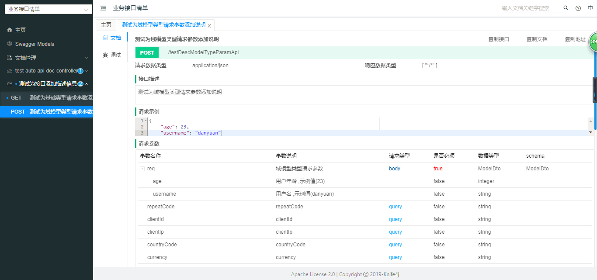

<center><h1>easy-spring-boot-api框架swagger接口文档工具使用示例</h1></center>

# 简介
> 此项目介绍如何使用easyapi内置的swagger+knife4j实现简单易用的实时API文档，支持在线调试接口！
>
> 此项目只演示简单入门示例，更多接口文档使用细节请求参考swagger和knife4j官方文档!

* [demo源码传送门](../../../easy-spring-boot-api-simple-demos/api-doc-demo)

# 项目示例

## 1 项目结构

* 项目结构

```ruby
├─src
│  └─main
│     ├─java
│     │  └─com
│     │      └─pddon
│     │          └─framework
│     │              └─demo
│     │                  └─easyapi
│     │                      ├─doc
│     │                      │  └─controller
│     │                      │      │  TestAutoApiDocController.java
│     │                      │      │  TestDecorateApiDocController.java
│     │                      │      │  TestIgnoreApiDocController.java
│     │                      │      └─dto
│     │                      │              ModelDto.java
│     │                      │
│     │                      └─startup
│     │                              Startup.java #项目启动类
│     └─resources
│             application.yml #服务端口8089
└─pom.xml
```

* 引入模块依赖，在`pom.xml`添加

```xml
<dependency>
    <groupId>com.pddon.framework</groupId>
    <artifactId>easy-spring-boot-api</artifactId>
</dependency>
```

> 版本由父工程`easy-spring-boot-api-simple-demos`的`dependencyManagement`统一管理（`easy-spring-boot-api.version` = 2.0.8）。

## 2 启用EasyApi框架

```java
package com.pddon.framework.demo.easyapi.startup;

import org.springframework.boot.SpringApplication;
import org.springframework.boot.autoconfigure.SpringBootApplication;
import org.springframework.context.annotation.ComponentScan;

import com.pddon.framework.easyapi.annotation.EnableEasyApi;

/**
 * swagger 接口文档示例启动类。
 */
@SpringBootApplication
@ComponentScan(basePackages = "com.pddon.framework.demo.easyapi")
@EnableEasyApi
public class Startup {

    public static void main(String[] args) {
        SpringApplication.run(Startup.class, args);
    }
}
```

## 3 接口文档示例

### 3.1 不添加任何注释的接口文档

> easyapi会自动为你生成接口文档

* 接口源码`TestAutoApiDocController.java`

```java
package com.pddon.framework.demo.easyapi.doc.controller;

import org.springframework.web.bind.annotation.GetMapping;
import org.springframework.web.bind.annotation.PathVariable;
import org.springframework.web.bind.annotation.RequestParam;
import org.springframework.web.bind.annotation.RestController;

/**
 * 不添加任何注释的接口，easyapi/springfox 会自动生成接口文档。
 */
@RestController
public class TestAutoApiDocController {

    @GetMapping("/{age}/testNoDescApi")
    public String testNoDescApi(@RequestParam(required = false) String username, @PathVariable Integer age) {
        return "测试无接口注释时自动生成的接口文档! username=" + username + ", age=" + age;
    }
}
```

### 3.2 屏蔽某些接口文档

> easyapi提供了注解忽略某些接口，使其不展示在接口文档中，但是你仍然可以访问这部分接口。

* 接口源码`TestIgnoreApiDocController.java`

```java
package com.pddon.framework.demo.easyapi.doc.controller;

import org.springframework.web.bind.annotation.GetMapping;
import org.springframework.web.bind.annotation.RestController;

import springfox.documentation.annotations.ApiIgnore;

/**
 * 使用 @ApiIgnore 屏蔽接口文档，但接口仍然可以正常访问。
 */
@RestController
@ApiIgnore
public class TestIgnoreApiDocController {

    @GetMapping("/testInnerApi")
    public String testInnerApi() {
        return "调用内部隐私接口成功!";
    }
}
```

### 3.3 为接口添加额外的描述信息

> 你可以为你的接口添加说明信息，以便于使用者更清晰的知道接口的意图。

* 源码`TestDecorateApiDocController.java`

```java
package com.pddon.framework.demo.easyapi.doc.controller;

import io.swagger.annotations.Api;
import io.swagger.annotations.ApiImplicitParam;
import io.swagger.annotations.ApiImplicitParams;
import io.swagger.annotations.ApiOperation;

import org.springframework.web.bind.annotation.GetMapping;
import org.springframework.web.bind.annotation.PostMapping;
import org.springframework.web.bind.annotation.RequestBody;
import org.springframework.web.bind.annotation.RequestParam;
import org.springframework.web.bind.annotation.RestController;

import com.pddon.framework.demo.easyapi.doc.controller.dto.ModelDto;

/**
 * 为接口添加额外的描述信息。
 */
@RestController
@Api(tags = "测试为接口添加描述信息")
public class TestDecorateApiDocController {

    @GetMapping("/testDescBaseTypeParamApi")
    @ApiOperation(value = "测试为基础类型请求参数添加说明", notes = "测试为基础类型请求参数添加说明")
    @ApiImplicitParams({
            @ApiImplicitParam(name = "username", value = "用户名", required = false, defaultValue = "danyuan"),
            @ApiImplicitParam(name = "age", value = "年龄", required = true, defaultValue = "23")
    })
    public String testDescBaseTypeParamApi(@RequestParam(required = false) String username,
                                           @RequestParam Integer age) {
        return "测试为基础类型请求参数添加说明! username=" + username + ", age=" + age;
    }

    @PostMapping("/testDescModelTypeParamApi")
    @ApiOperation(value = "测试为域模型类型请求参数添加说明", notes = "测试为域模型类型请求参数添加说明")
    public String testDescModelTypeParamApi(@RequestBody ModelDto req) {
        return "测试为域模型类型请求参数添加说明！ username=" + req.getUsername() + ", age=" + req.getAge();
    }
}
```

* 源码`ModelDto.java`

```java
package com.pddon.framework.demo.easyapi.doc.controller.dto;

import java.io.Serializable;

import javax.validation.constraints.NotNull;

import io.swagger.annotations.ApiModel;
import io.swagger.annotations.ApiModelProperty;

/**
 * 域模型类型请求参数。
 */
@ApiModel(description = "域模型类型请求参数")
public class ModelDto implements Serializable {

    private static final long serialVersionUID = 1L;

    @ApiModelProperty(required = false, allowEmptyValue = false, notes = "用户名", example = "danyuan")
    private String username;

    @ApiModelProperty(required = false, allowEmptyValue = false, notes = "用户年龄", example = "23")
    @NotNull
    private Integer age;

    public String getUsername() {
        return username;
    }

    public void setUsername(String username) {
        this.username = username;
    }

    public Integer getAge() {
        return age;
    }

    public void setAge(Integer age) {
        this.age = age;
    }
}
```

## 4 配置信息

> 本示例的`application.yml`关键配置如下，接口文档分组名为`business-api`

```yaml
server:
  port: 8089
spring:
  application:
    name: api-doc-demo
knife4j:
  basic:
    # 示例方便测试，关闭 knife4j 的 basic 认证
    enable: false
easyapi:
  enable: true
  enableSwagger: true
  basePackages: com.pddon.framework.demo.easyapi
  api:
    channels:
      default:
        webApp:
          secret: NKVNcuwwEF76622A
    swagger:
      # 分组名称使用 ASCII，便于 /v3/api-docs?group=... 直接调用
      title: business-api
      description: easy-spring-boot-api api-doc-demo
      basePackage: com.pddon.framework.demo.easyapi
```

> 启动后可访问接口文档页面`http://localhost:8089/doc.html`，接口文档JSON为`http://localhost:8089/v3/api-docs?group=business-api`。

# 结果示例


